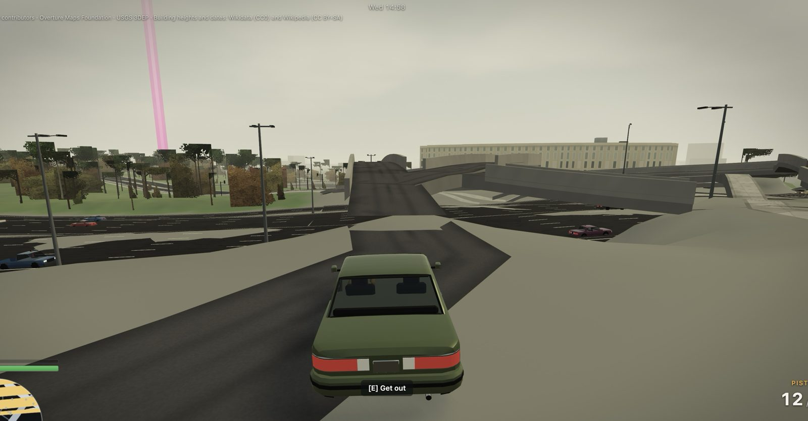
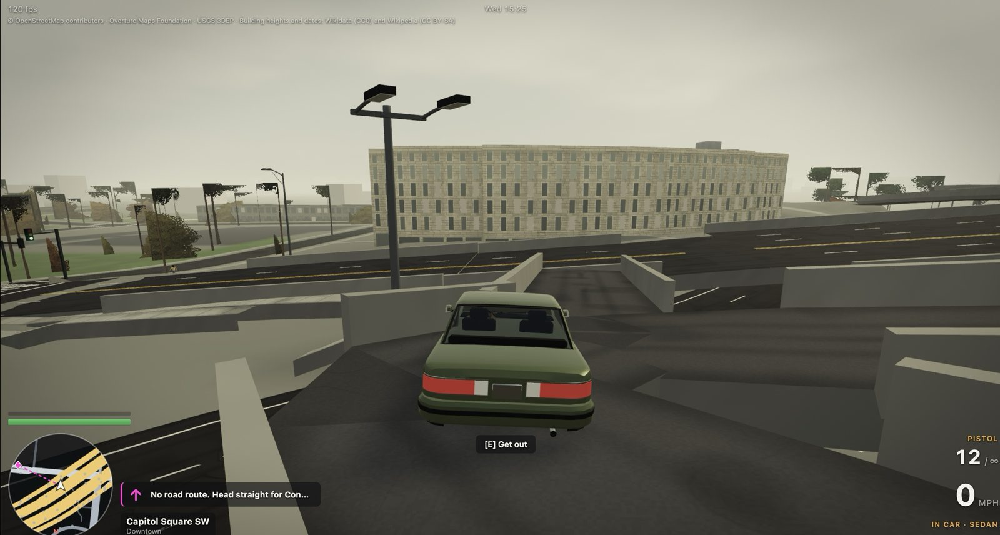
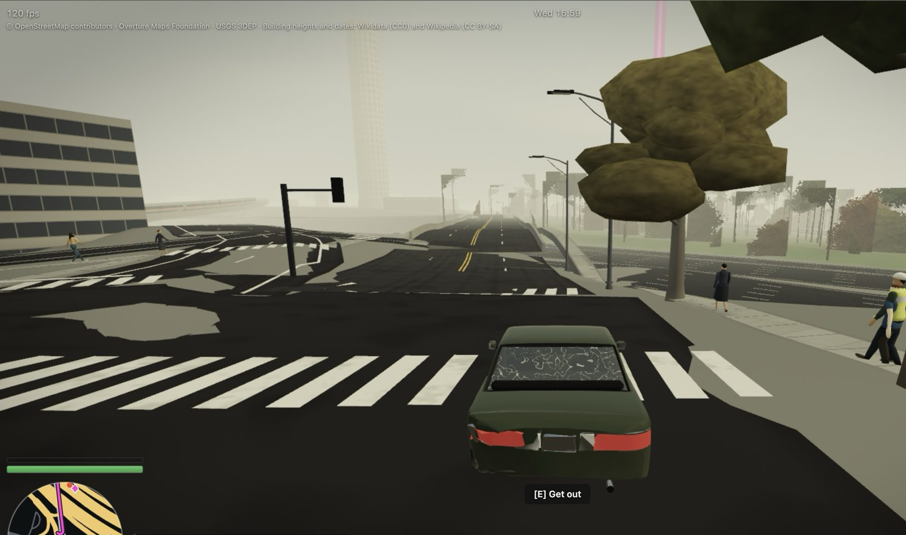

# Fixes roadmap

Known problems, worst first. Owner reports carry a screenshot. Agent findings carry coordinates in game metres, with x east and z south of Five Points, on the M1 tile. Remove an entry when it ships, and record the fix in its commit.

Last updated 16 Oct 2026.

## P1: Roads and overpasses (owner, 16 Oct)

The ground audit says there are no launches on smooth road. These problems are the drawn road and deck network itself, and they need a pass by the ground lane.

### 1. An overpass ramp humps up and goes nowhere; road surfaces end in blunt slabs

- **Where:** near the Capitol and I-20 deck network.
- **What:** a deck rises into a hump and stops mid-air. Carriageways meet grey ground slabs with blunt ends instead of joining. One deck sits askew.
- **Likely causes:**
  - deck ribbons whose OSM ways end at a bridge joint;
  - the derived-bridge landings;
  - the ground carve around junctions.

  Compare with the "Residuals" list in `docs/ground-audit.md`.

### 2. Barriers box a car in on a deck stub; the GPS finds no route

- **Where:** Capitol Square SW.
- **What:**
  - The new deck barriers (round 9) close off a short deck piece on three sides, so the car is trapped on a stub.
  - The GPS says "No road route. Head straight for…", because that stub isn't connected in the lane graph.
- **Fix direction:**
  - Leave barriers open wherever a lane continues off the deck, not only at deck-to-deck forks.
  - Check every deck piece for a drivable exit.
  - Add a verify check: no lane on a deck may end against a barrier.

### 3. Junction surfaces break into blobs; a raised hump mid-road

- **What:**
  - Junction polygons render as separate dark and grey patches (asphalt and sidewalk material mixed, islands) instead of one clean surface.
  - A short raised hump sits on an otherwise flat street.
- **Fix direction:** the junction polygon builder (`tools/pipeline/src/world/junctions.ts`), the fan triangulation on large irregular junctions, and road-profile crests on short ways.

### 4. Earlier ground residuals, still open (agent findings)

- **Seam launches** (about 115 events in 27 places). Map steps of about 0.22 m under a car's footprint.
  - MLK Dr and the I-20 ramps: (385, 655), (347, 629).
  - Pryor St over the rail gulch: (704, -844), (719, -836).
  - The Connector fork: (925, 288).
  - Wide-carriageway edges: (932, 164), (944, 145).
  - Northside Dr: (-562, 195).
  - Memorial Dr over I-20: (202, 811).
- **Steep service-road joins** on Memorial over I-20: 563545717 at 19%, and 561203363 at 17%.
- **The Connector's two carriageways** at (690, 480): 3 m apart and 4 m apart in height.
- **M2 seam gap:** several northbound lanes in M2 tile `0_0` stop 1–4 m short of the z = 0 seam, so routes north of the Capitol detour 4–5 km. That's a bake fix, not a GPS fix.
- **Six unmatched M2 lane ports** (ways 631611892, 1040543348, 9245347).

## P2: Gameplay and world

- **GPS:** walking turns near unnamed service roads show blank street names.
- **Aim pose** (the upside-down bend is fixed): at +45° and above the pistol arms go almost straight up, and the rifle sits 10–20° low when aiming up. Crouched aim is never played (the sim never sets crouch and aim together).
- **Big map:** no parks or water yet (needs the tile's land-class mesh), and the hint line can sit over labels.
- **Georgia State Capitol hero:** the main portico faces **west onto Washington St**. Remove the extra east portico (`landmarks.json` note).
- **Landmark positions:** 25 still unverified (`landmarks.json` notes). Overpass was overloaded.
- **People:**
  - The face is a painted mask; fingers exist only up close.
  - Get-up animations are built but not played.
  - The rifle mount is roughly tuned, and shoes are a bit platform-like.
- **Trees:** a visible switch between detail levels at about 30 m, and distant trees are plain silhouettes at night.
- **Car sodium light:** strength set to 0.35 by eye; check at night.
- **Peds on freeways:** fixed in round 9. Recheck after any M2 bake.

## P2: Harness and performance housekeeping

- **`perf-budget`:** budgets are stale after rounds 8–9 (landmarks, trees, people, freeway traffic). Re-baseline on a quiet machine (load under 2) by hand: best of two runs, and no `--write-budget` on noisy p95 values.
- **The 5-minute soak:** re-run on a quiet machine. The last run was at load 23, so its CPU-per-draw drift isn't meaningful.
- **Real devices:** the Mac measured 120 fps in Chrome. The iPhone 15 Pro hasn't been checked yet; see the checklist in `docs/deploy.md`.

## In progress (16 Oct)

- **Peach Rapid Transit:** tunnels, stations, trains and riding.
- **Hartsfield-Jackson:** its own tile region, terminals, an interior and AI aircraft.
- **The M2 bake** (Midtown, Inman Park, Little Five Points, Candler Park, Buckhead, Vinings): waits on the Overpass prefetch, which keeps hitting 502 and 500 errors.

## Tools now on the dev box (owner, 16 Oct)

- **Installed:** ffmpeg, espeak-ng, the gltf-transform CLI, the Piper TTS engine (`~/.local/share/piper-venv`, **no voice yet**), toktx/KTX v4.4.2 (`~/.local/bin`), and **MPFB2 v2.0.18 with the MakeHuman assets** in Blender 5.2.2. MPFB2 works in the GUI; headless use is untested.
- **Next uses:**
  - Try MPFB2 headless as a base for more realistic people (CC0 assets).
  - KTX2 textures for P3 of the graphics plan.
  - Piper barks once a voice with a confirmed redistributable licence is picked. Avoid ryan-high and lessac; en_US-amy is unconfirmed.
- **Licences:** log every third-party asset in `assets/LICENSES.md`.

## Later (owner wish list)

- **Flyable aircraft and helicopters** you can steal (the airport's aircraft entities are designed for it).
- **The rest of the metro:** the M3 compression warp, the King and Queen towers, Stone Mountain and the lakes.
- **Voice and dialogue,** once licence-safe voices are picked (`docs/tools-wishlist.md`).
